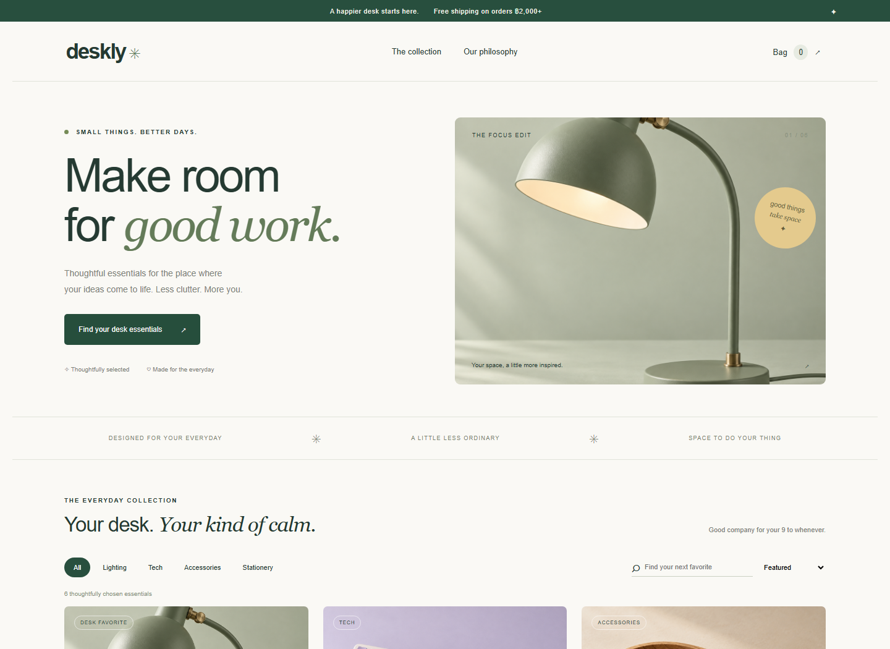
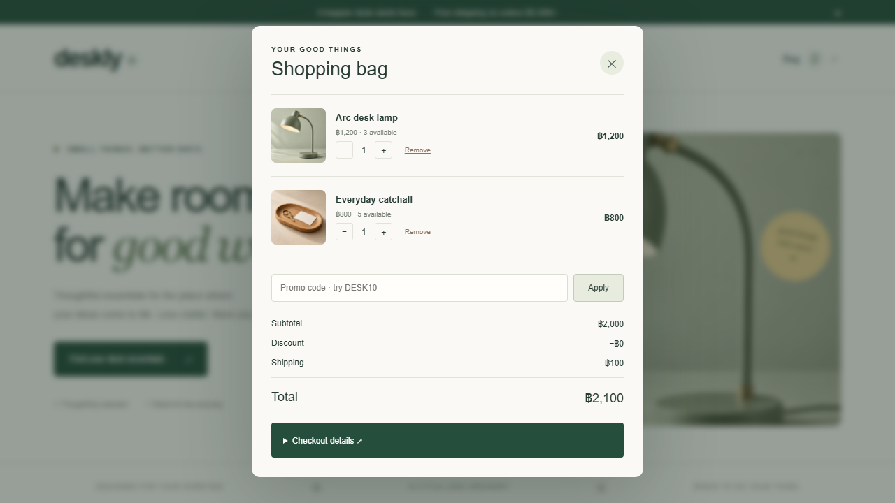
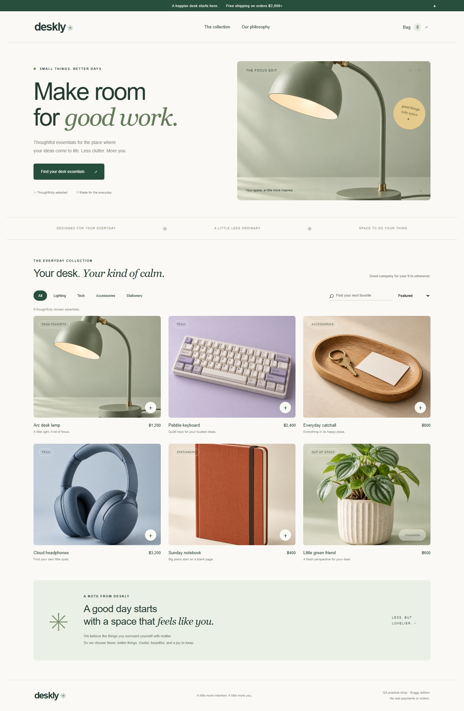
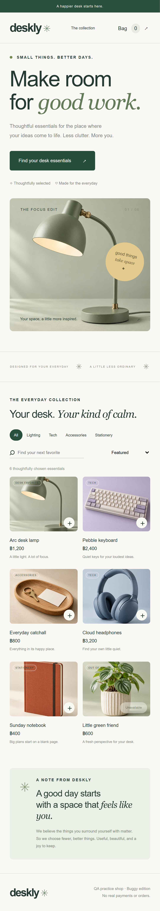

<div align="center">

# Deskly

### A thoughtful storefront. A deliberate QA challenge.

An experiment in directing **Codex** to create a local storefront<br>
and its **QA automation workflow in TypeScript**.


[English](#english) · [ภาษาไทย — scroll down](#thai)

[Quick start](#quick-start) · [Test results](#recorded-test-results) · [QA artifacts](#qa-artifacts) · [Defects](#six-intentional-defects)

</div>



<a id="english"></a>

## English

## About the project

Deskly is a local desk essentials shop built as a realistic QA practice environment. Customers can search and filter products, sort prices, manage a shopping bag, apply a promo code, and complete a simulated checkout.

The default edition contains **six intentional defects**. A corrected edition lets the same requirement-based tests demonstrate verification after a fix. The project follows the complete QA workflow:

**Requirement → test case → automated assertion → failure evidence → bug report → verification.**

Product images are locally bundled, AI-generated studio photographs. Orders and payments are simulated; the project does not require a backend or deployment.

## A 100% AI-generated project, directed by a human

**Deskly is an experimental project created to practice using Codex across website development and QA automation. All project-specific code, automated tests, QA documents, README content, and product imagery were generated using AI tools.** Codex produced the implementation and QA workflow; AI image-generation tools produced the product photographs. Test results were recorded from actual browser executions.

I initiated the project and acted as the **Project Initiator & AI Workflow Director**. My contribution was to define the brief, set the design direction and scope, specify constraints, and provide feedback as the result took shape. These included a polished local storefront, deliberately seeded bugs, Playwright tests in TypeScript, product photography, and bilingual documentation.

I directed the work through prompts and feedback. Codex translated those instructions into the application structure, implementation details, test strategy, and documentation. I did not manually write the application or test code.

| Responsibility                         | Contribution                                                                                                           |
| -------------------------------------- | ---------------------------------------------------------------------------------------------------------------------- |
| Human: project intent and direction    | Define the idea, desired experience, scope, technical constraints, and feedback                                        |
| Codex: architecture and implementation | Turn the brief into project structure, application logic, and local setup                                              |
| Codex: QA workflow                     | Generate requirements, test cases, seeded defects, Playwright tests, and QA documents; run checks and collect evidence |
| AI image-generation tools              | Generate locally bundled product photographs                                                                           |

Here, **100% AI-generated** refers to the project-authored deliverables. It does not mean there was no human direction, or that third-party frameworks and dependencies were authored by AI.

The experiment explores how far a human-defined brief can be carried through by AI: from a visual website to an intentionally defective test application, then to repeatable automation and documented results. It is a record of practicing AI direction and evaluating generated output, rather than a claim of independent, hand-written software engineering.

## What the experiment covers

| Skill              | Implementation                                                                                 |
| ------------------ | ---------------------------------------------------------------------------------------------- |
| Manual test design | Acceptance criteria, risk-based test plan, 23 traceable cases                                  |
| Test techniques    | Equivalence partitioning, boundary values, negative validation, state transitions, idempotency |
| Automation         | TypeScript, Page Object Model, isolated contexts, user-facing locators                         |
| Defect analysis    | Reproduction, expected/actual results, severity, impact, correction, verification              |
| Evidence           | HTML/JSON reports, screenshots, videos, and traces                                             |
| Browser coverage   | Desktop Chromium, desktop Firefox, Pixel 7 emulation on Chromium                               |
| CI preparation     | GitHub Actions matrix for buggy/fixed editions with report artifacts                           |

## Quick start

**Prerequisites:** Node.js 22.12+ or 24+, and npm.

Run inside the project folder:

```sh
npm ci
npx playwright install chromium firefox
npm run dev
```

Open **[http://127.0.0.1:5173](http://127.0.0.1:5173)**.

The preview starts in the buggy edition. Stop with `Ctrl+C`, then run `npm run dev:fixed` for the corrected edition. Playwright manages its own server on port **5174** and never reuses a running preview.

## Run the tests

| Command              | Purpose                                                                             |
| -------------------- | ----------------------------------------------------------------------------------- |
| `npm test`           | Buggy baseline: 17 normal checks and six expected defect failures per configuration |
| `npm run test:fixed` | All 23 cases against the corrected edition                                          |
| `npm run test:audit` | Six defects as ordinary failures on Chromium                                        |
| `npm run test:smoke` | Five core cases across all three configurations                                     |
| `npm run test:ui`    | Explore tests in Playwright UI                                                      |
| `npm run report`     | Open the latest HTML report                                                         |
| `npm run build`      | Strict TypeScript checking and production build                                     |

> **Read a green baseline carefully.** Known defects use `test.fail`: the tests still execute and assert the intended behavior. The baseline succeeds when those checks fail as expected and normal checks pass. An unexpected pass is also an error. A successful baseline does **not** mean the buggy product meets every requirement.

Audit mode intentionally exits with a nonzero code. Fixed mode uses the same assertions without expected-failure marking. The configuration uses one worker and zero retries; the observed Firefox concurrency issue is recorded in the execution document.

## Recorded test results

Local verification on **9 October 2026**:

| Mode               | Executions | Actual passes | Actual failures | Interpretation                                           |
| ------------------ | ---------: | ------------: | --------------: | -------------------------------------------------------- |
| Buggy baseline     |         69 |            51 |              18 | Six known defects reproduced on each configuration       |
| Fixed verification |         69 |            69 |               0 | All automated checks passed                              |
| Defect audit       |          6 |             0 |               6 | All seeded defects exposed as ordinary Chromium failures |

**23 cases × 3 configurations = 69 executions per full run.** Mobile coverage is browser emulation, not a physical device. These are recorded local results; GitHub Actions is configured but has not yet run remotely.

See the [execution record](docs/TEST_EXECUTION.md) for timestamps, evidence, and the initial infrastructure finding.

<details>
<summary><strong>Defect evidence example: the free-shipping boundary</strong></summary>

A ฿1,200 lamp and a ฿800 catchall reach the advertised ฿2,000 threshold. The buggy edition still charges ฿100 shipping; the requirement expects ฿0.



[Read BUG-005](docs/BUG_REPORTS.md#bug-005) · [View audit results](docs/evidence/audit-summary.json)

</details>

## Six intentional defects

| ID      | Incorrect behavior                         | Test technique           |
| ------- | ------------------------------------------ | ------------------------ |
| BUG-001 | Lowercase search misses matching products  | Equivalence partitioning |
| BUG-002 | Prices sort as strings rather than numbers | Numeric ordering oracle  |
| BUG-003 | Bag quantity exceeds available stock       | Boundary testing         |
| BUG-004 | Reapplying DESK10 stacks the discount      | Idempotency testing      |
| BUG-005 | Shipping charged at exactly ฿2,000         | Boundary value analysis  |
| BUG-006 | Whitespace-only checkout fields accepted   | Negative validation      |

Each defect maps to an automated case, an acceptance criterion, and a [bug report](docs/BUG_REPORTS.md).

## QA artifacts

| Document                                   | Contents                                                                |
| ------------------------------------------ | ----------------------------------------------------------------------- |
| [Requirements](docs/REQUIREMENTS.md)       | Business rules and acceptance criteria                                  |
| [Test plan](docs/TEST_PLAN.md)             | Scope, risks, approach, entry/exit criteria, exploratory follow-ups     |
| [Test cases](docs/TEST_CASES.md)           | Steps, data, expected results, priorities, requirement mapping          |
| [Bug reports](docs/BUG_REPORTS.md)         | Reproduction, expected/actual results, impact, correction, verification |
| [Execution record](docs/TEST_EXECUTION.md) | Actual local results and evidence                                       |
| [Thai walkthrough](docs/GUIDE_TH.md)       | Usage and interview demonstration guide                                 |
| [Image assets](docs/ASSETS.md)             | Local asset paths and exact generation prompts                          |

Generated evidence lives in `playwright-report/` and `test-results/`; both are ignored by Git. The next run replaces the latest report. After a run, use `npm run evidence -- buggy`, `fixed`, or `audit` to save a compact JSON summary under `docs/evidence/`.

## Project structure

```text
deskly-qa/
├── src/                       Storefront, catalog, image helpers, styles
├── public/images/             Six local product photographs
├── tests/
│   ├── pages/shop.page.ts      Reusable customer actions
│   └── shop.spec.ts            23 requirement-based test cases
├── docs/                      QA documents, previews, recorded evidence
├── scripts/                   Preview capture and evidence summaries
├── .github/
│   ├── workflows/qa.yml        Buggy / fixed CI matrix
│   └── ISSUE_TEMPLATE/         Structured bug-report form
├── playwright.config.ts       Browser matrix, server, reporters
└── README.md                  English + Thai in one document
```

**Stack:** TypeScript · Playwright Test · Vite · HTML/CSS · localStorage · GitHub Actions.

<details>
<summary><strong>Desktop and mobile previews</strong></summary>





</details>

## Publish the repository on GitHub

Create an empty repository, then run inside this project folder:

```sh
git init
git add .
git commit -m "Add Deskly QA automation portfolio"
git branch -M main
git remote add origin https://github.com/YOUR_USERNAME/deskly-qa-portfolio.git
git push -u origin main
```

Replace `YOUR_USERNAME` with your account. The workflow installs browsers, builds the app, tests both editions, and retains report artifacts for 14 days. It does not deploy the storefront.

## Scope of the experiment

This training storefront uses browser-local state. Real payments, authentication, backend/API tests, load tests, a full accessibility audit, and visual baseline comparisons are outside its scope. The corrected edition fixes the documented defects; it is not a production-readiness claim.

The application and its test suite were generated within the same AI-directed workflow. Passing checks show the recorded behavior covered by those tests; they are not an independent audit of all possible defects. An interview walkthrough can explain the original brief, the prompts and feedback used to steer the work, one reproduced defect, and how the same assertion verifies the corrected edition.

## License and references

Released under the [MIT License](LICENSE).

Official documentation: [Playwright annotations](https://playwright.dev/docs/test-annotations) · [Test server management](https://playwright.dev/docs/test-webserver).

---

<a id="thai"></a>

# ภาษาไทย

[↑ Back to English](#english) · [เริ่มใช้งาน](#เริ่มใช้งาน) · [ผลทดสอบ](#ผลทดสอบที่บันทึกไว้)

## เกี่ยวกับโปรเจกต์

Deskly เป็นเว็บร้านอุปกรณ์โต๊ะทำงานที่รันบนเครื่อง ใช้ฝึก QA ผ่านสถานการณ์ใกล้เคียงร้านค้าจริง ผู้ใช้สามารถค้นหา กรองสินค้า เรียงราคา จัดการตะกร้า ใช้คูปอง และทำ checkout แบบจำลองได้

เวอร์ชันเริ่มต้นมี **บั๊กที่ตั้งใจใส่ไว้ 6 ตัว** พร้อมเวอร์ชันแก้บั๊กสำหรับนำเทสต์ชุดเดิมมาตรวจสอบหลังแก้ไข โปรเจกต์นี้แสดงกระบวนการ QA ตั้งแต่ต้นจนจบ:

**Requirement → Test case → Automated assertion → หลักฐานความผิดพลาด → Bug report → Verification**

ภาพสินค้าเป็นภาพแนวถ่ายสตูดิโอที่สร้างด้วย AI และเก็บไฟล์ไว้ในโปรเจกต์ การสั่งซื้อและชำระเงินเป็นการจำลอง ใช้งานได้โดยไม่ต้องมี backend หรือ deploy เว็บ

## งานที่สร้างด้วย AI 100% ภายใต้การกำหนดทิศทางของมนุษย์

**Deskly เป็นโปรเจกต์ทดลองเพื่อฝึกใช้ Codex ทำงานทั้งด้านพัฒนาเว็บไซต์และ QA Automation โดยโค้ดเฉพาะของโปรเจกต์ เทสต์อัตโนมัติ เอกสาร QA เนื้อหา README และภาพสินค้า สร้างผ่านเครื่องมือ AI ทั้งหมด** Codex จัดทำส่วน implementation และ QA workflow ส่วนเครื่องมือสร้างภาพด้วย AI จัดทำภาพสินค้า ผลทดสอบที่บันทึกไว้มาจากการรัน browser จริง

ผู้จัดทำมีบทบาทเป็น **ผู้ริเริ่มโปรเจกต์และผู้กำหนดทิศทางการทำงานของ AI (Project Initiator & AI Workflow Director)** โดยรับผิดชอบการกำหนดโจทย์ ทิศทางดีไซน์ ขอบเขต ข้อจำกัด และให้ข้อเสนอแนะระหว่างพัฒนา เช่น ต้องเป็นเว็บที่สวยและรันบนเครื่อง มีบั๊กที่ตั้งใจใส่ไว้ ใช้ Playwright ภาษา TypeScript มีภาพสินค้า และเอกสารสองภาษา

บทบาทของผู้จัดทำคือสื่อสารสิ่งที่ต้องการผ่าน prompts และ feedback ส่วน Codex นำข้อกำหนดเหล่านั้นไปออกแบบโครงสร้างแอป เลือกรายละเอียดการพัฒนา วางแนวทางทดสอบ และจัดทำเอกสาร โดยผู้จัดทำไม่ได้ลงมือเขียนโค้ดแอปหรือเทสต์ด้วยตนเอง

| ผู้รับผิดชอบ                         | บทบาท                                                                                                    |
| ------------------------------------ | -------------------------------------------------------------------------------------------------------- |
| ผู้ริเริ่มโปรเจกต์: แนวคิดและทิศทาง  | กำหนดไอเดีย ประสบการณ์ที่ต้องการ ขอบเขต ข้อจำกัดทางเทคนิค และให้ feedback                                |
| Codex: สถาปัตยกรรมและ implementation | แปลงโจทย์เป็นโครงสร้างโปรเจกต์ logic ของแอป และการตั้งค่ารัน local                                       |
| Codex: QA workflow                   | สร้าง requirements, test cases, seeded defects, Playwright tests และเอกสาร QA พร้อมรันตรวจและเก็บหลักฐาน |
| เครื่องมือสร้างภาพด้วย AI            | สร้างภาพสินค้าที่เก็บไว้ในโปรเจกต์                                                                       |

คำว่า **AI 100%** ในที่นี้หมายถึงชิ้นงานที่จัดทำเฉพาะสำหรับโปรเจกต์ ไม่ได้หมายความว่าไม่มีมนุษย์กำหนดทิศทาง หรือ framework และ dependencies ของบุคคลอื่นถูกสร้างด้วย AI

เป้าหมายของการทดลองคือศึกษาว่า AI สามารถนำโจทย์ที่มนุษย์กำหนดไปทำงานต่อได้มากเพียงใด ตั้งแต่เว็บไซต์ที่มีดีไซน์ ไปจนถึงเว็บที่ตั้งใจให้มีข้อผิดพลาด ชุดทดสอบที่รันซ้ำได้ และเอกสารผลทดสอบ โปรเจกต์นี้จึงเป็นบันทึกการฝึกกำกับ AI และประเมินผลงานที่สร้างขึ้น ไม่ใช่การอ้างว่าพัฒนาและเขียนโค้ดทุกส่วนด้วยตนเอง

## สิ่งที่การทดลองครอบคลุม

| ทักษะ                | สิ่งที่ทำในโปรเจกต์                                                                               |
| -------------------- | ------------------------------------------------------------------------------------------------- |
| ออกแบบ Manual test   | Acceptance criteria, แผนทดสอบตามความเสี่ยง และ 23 เคสที่เชื่อมกับ requirement                     |
| เทคนิคการทดสอบ       | Equivalence partitioning, Boundary values, Negative validation, State transitions และ Idempotency |
| เขียน Automation     | TypeScript, Page Object Model, contexts แยกแต่ละเคส และ locators ตามการใช้งานจริง                 |
| วิเคราะห์บั๊ก        | ขั้นตอนทำซ้ำ, Expected/Actual, Severity, ผลกระทบ, แนวทางแก้ และการตรวจซ้ำ                         |
| เก็บหลักฐาน          | รายงาน HTML/JSON, ภาพหน้าจอ, วิดีโอ และ traces                                                    |
| ทดสอบหลายสภาพแวดล้อม | Desktop Chromium, Desktop Firefox และ Pixel 7 emulation บน Chromium                               |
| เตรียม CI            | GitHub Actions แยก buggy/fixed mode พร้อมแนบ report artifacts                                     |

## เริ่มใช้งาน

**สิ่งที่ต้องมี:** Node.js 22.12 ขึ้นไป หรือ 24 ขึ้นไป และ npm

เปิด terminal ในโฟลเดอร์โปรเจกต์ แล้วรัน:

```sh
npm ci
npx playwright install chromium firefox
npm run dev
```

เปิด **[http://127.0.0.1:5173](http://127.0.0.1:5173)**

เว็บจะเริ่มในโหมดที่มีบั๊ก หากต้องการดูเวอร์ชันแก้บั๊ก ให้หยุดด้วย `Ctrl+C` แล้วรัน `npm run dev:fixed` ส่วน Playwright จะเปิดเซิร์ฟเวอร์ทดสอบของตัวเองที่พอร์ต **5174** โดยไม่ใช้ preview ที่เปิดค้างอยู่

## รันชุดทดสอบ

| คำสั่ง               | ใช้ทำอะไร                                                                   |
| -------------------- | --------------------------------------------------------------------------- |
| `npm test`           | ตรวจ baseline: 17 เคสปกติ และ 6 เคสที่ต้องพบ known defect ต่อ configuration |
| `npm run test:fixed` | รันครบ 23 เคสกับเวอร์ชันแก้บั๊ก                                             |
| `npm run test:audit` | แสดงบั๊กทั้ง 6 ตัวเป็น failed ปกติบน Chromium                               |
| `npm run test:smoke` | รัน 5 เคสหลักบนทั้งสาม configurations                                       |
| `npm run test:ui`    | เปิด Playwright UI เพื่อสำรวจและรันเทสต์                                    |
| `npm run report`     | เปิดรายงาน HTML ล่าสุด                                                      |
| `npm run build`      | ตรวจ TypeScript แบบ strict และ build เว็บ                                   |

> **อ่าน baseline สีเขียวอย่างไร:** เคส known defect ใช้ `test.fail` จึงยังรันจริงและตรวจพฤติกรรมที่ควรเป็น ชุด baseline จะสำเร็จเมื่อเคสเหล่านี้ล้มเหลวตามที่ระบุ และเคสปกติผ่าน หาก known defect กลับผ่าน จะถือเป็น unexpected pass ด้วย ผล baseline ที่สำเร็จจึงไม่ได้แปลว่าเว็บผ่านทุก requirement

Audit mode จะคืน exit code ที่ไม่ใช่ศูนย์โดยตั้งใจ ส่วน fixed mode ใช้ assertions เดิมโดยไม่ระบุ expected failure การตั้งค่าปัจจุบันใช้หนึ่ง worker และไม่มี retries โดยบันทึกปัญหา Firefox เมื่อรันพร้อมกันไว้ใน execution record

## ผลทดสอบที่บันทึกไว้

ผลตรวจบนเครื่องเมื่อ **9 ตุลาคม 2026**:

| โหมด               | จำนวน executions | ผ่านจริง | ล้มเหลวจริง | ความหมาย                                           |
| ------------------ | ---------------: | -------: | ----------: | -------------------------------------------------- |
| Buggy baseline     |               69 |       51 |          18 | พบ known defects 6 ตัวซ้ำได้ในแต่ละ configuration  |
| Fixed verification |               69 |       69 |           0 | Automated checks ผ่านครบทั้งหมด                    |
| Defect audit       |                6 |        0 |           6 | แสดง seeded defects ครบเป็น failed ปกติบน Chromium |

**23 เคส × 3 configurations = 69 executions ต่อ full run** การทดสอบมือถือเป็น browser emulation ไม่ใช่อุปกรณ์จริง ผลข้างต้นเป็นผลที่ตรวจบนเครื่องแล้ว ส่วน GitHub Actions มีการตั้งค่าไว้ แต่ยังไม่ได้รันบน GitHub

อ่านเวลาเริ่มทดสอบ หลักฐาน และปัญหา infrastructure ที่พบใน [execution record](docs/TEST_EXECUTION.md)

<details>
<summary><strong>ตัวอย่างหลักฐานบั๊ก: ค่าส่งตรงขอบเขตโปรโมชั่น</strong></summary>

เพิ่มโคมไฟราคา 1,200 บาท และถาดราคา 800 บาท จะได้ subtotal เท่ากับ 2,000 บาทตามเงื่อนไขส่งฟรี แต่เวอร์ชันมีบั๊กยังคิดค่าส่ง 100 บาท ขณะที่ requirement กำหนดให้เป็น 0 บาท


[อ่าน BUG-005](docs/BUG_REPORTS.md#bug-005) · [ดูผล audit](docs/evidence/audit-summary.json)

</details>

## บั๊กที่ตั้งใจใส่ไว้ 6 ตัว

| ID      | พฤติกรรมที่ผิด                                   | เทคนิคการทดสอบ           |
| ------- | ------------------------------------------------ | ------------------------ |
| BUG-001 | ค้นหาด้วยตัวพิมพ์เล็กแล้วไม่พบสินค้าที่ควรตรงกัน | Equivalence partitioning |
| BUG-002 | เรียงราคาแบบข้อความแทนตัวเลข                     | Numeric ordering oracle  |
| BUG-003 | เพิ่มจำนวนสินค้าในตะกร้าเกินสต็อกได้             | Boundary testing         |
| BUG-004 | ใช้ DESK10 ซ้ำแล้วส่วนลดทบเพิ่ม                  | Idempotency testing      |
| BUG-005 | ยังคิดค่าส่งเมื่อ subtotal เท่ากับ 2,000 บาท     | Boundary value analysis  |
| BUG-006 | ยอมรับชื่อและที่อยู่ที่กรอกเป็นช่องว่างล้วน      | Negative validation      |

แต่ละบั๊กเชื่อมกับ automated case, acceptance criterion และ [bug report](docs/BUG_REPORTS.md)

## เอกสาร QA

| เอกสาร                                     | เนื้อหา                                                            |
| ------------------------------------------ | ------------------------------------------------------------------ |
| [Requirements](docs/REQUIREMENTS.md)       | กฎธุรกิจและ acceptance criteria                                    |
| [Test plan](docs/TEST_PLAN.md)             | ขอบเขต ความเสี่ยง แนวทาง เกณฑ์เริ่ม/จบ และ exploratory follow-ups  |
| [Test cases](docs/TEST_CASES.md)           | ขั้นตอน ข้อมูล ผลที่คาดหวัง ลำดับความสำคัญ และ requirement mapping |
| [Bug reports](docs/BUG_REPORTS.md)         | ขั้นตอนทำซ้ำ Expected/Actual ผลกระทบ แนวทางแก้ และการตรวจซ้ำ       |
| [Execution record](docs/TEST_EXECUTION.md) | ผลทดสอบจริงและตำแหน่งหลักฐาน                                       |
| [คู่มือสาธิตภาษาไทย](docs/GUIDE_TH.md)     | วิธีใช้และแนวทางอธิบายโปรเจกต์ในสัมภาษณ์                           |
| [Image assets](docs/ASSETS.md)             | ตำแหน่งไฟล์ภาพและ prompts ที่ใช้สร้าง                              |

หลักฐานที่สร้างระหว่างรันอยู่ใน `playwright-report/` และ `test-results/` ซึ่งไม่ถูกนำเข้า Git การรันครั้งถัดไปจะแทนที่รายงานล่าสุด หลังทดสอบใช้ `npm run evidence -- buggy`, `fixed` หรือ `audit` เพื่อบันทึกผลสรุป JSON ไว้ใน `docs/evidence/`

## โครงสร้างโปรเจกต์

```text
deskly-qa/
├── src/                       เว็บร้านค้า catalog ตัวช่วยภาพ และ styles
├── public/images/             ภาพสินค้า 6 รายการที่เก็บไว้ในโปรเจกต์
├── tests/
│   ├── pages/shop.page.ts      การกระทำของผู้ใช้ที่เรียกใช้ซ้ำได้
│   └── shop.spec.ts            เทสต์ 23 เคสที่ตรวจตาม requirement
├── docs/                      เอกสาร QA ภาพเว็บ และหลักฐานที่บันทึกไว้
├── scripts/                   จับภาพ preview และสรุปผลทดสอบ
├── .github/
│   ├── workflows/qa.yml        CI matrix สำหรับ buggy / fixed
│   └── ISSUE_TEMPLATE/         แบบฟอร์มรายงานบั๊ก
├── playwright.config.ts       Browser matrix เซิร์ฟเวอร์ และ reporters
└── README.md                  ภาษาอังกฤษ + ภาษาไทยในไฟล์เดียว
```

**เทคโนโลยี:** TypeScript · Playwright Test · Vite · HTML/CSS · localStorage · GitHub Actions

<details>
<summary><strong>ภาพเว็บบน desktop และมือถือ</strong></summary>


</details>

## นำ repository ขึ้น GitHub

สร้าง repository ว่าง แล้วรันคำสั่งในโฟลเดอร์โปรเจกต์:

```sh
git init
git add .
git commit -m "Add Deskly QA automation portfolio"
git branch -M main
git remote add origin https://github.com/YOUR_USERNAME/deskly-qa-portfolio.git
git push -u origin main
```

เปลี่ยน `YOUR_USERNAME` เป็นบัญชี GitHub ของคุณ Workflow จะติดตั้ง browsers, build เว็บ, ทดสอบทั้งสองเวอร์ชัน และเก็บ report artifacts ไว้ 14 วัน โดยไม่ deploy เว็บร้านค้า

## ขอบเขตของการทดลอง

นี่คือเว็บฝึกทดสอบที่เก็บสถานะใน browser ขอบเขตไม่รวมการชำระเงินจริง Authentication, Backend/API tests, Load tests, Accessibility audit แบบเต็ม หรือการเปรียบเทียบ visual baselines เวอร์ชันแก้บั๊กแก้ไขข้อผิดพลาดที่บันทึกไว้ ไม่ใช่การรับรองว่าระบบพร้อมใช้งานจริง

ทั้งแอปและชุดทดสอบถูกสร้างภายใต้ workflow ที่กำกับ AI ชุดเดียวกัน ผลเทสต์ที่ผ่านจึงแสดงพฤติกรรมที่ตรวจตามเคสที่บันทึกไว้ ไม่ใช่การตรวจคุณภาพอย่างอิสระที่ครอบคลุมทุกบั๊ก ในการสัมภาษณ์สามารถอธิบายโจทย์เริ่มต้น prompts และ feedback ที่ใช้กำกับงาน ตัวอย่างบั๊กที่ทำซ้ำได้ และการใช้ assertion เดิมตรวจเวอร์ชันแก้ไข

## License และเอกสารอ้างอิง

เผยแพร่ภายใต้ [MIT License](LICENSE)

เอกสารทางการ: [Playwright annotations](https://playwright.dev/docs/test-annotations) · [Test server management](https://playwright.dev/docs/test-webserver)
